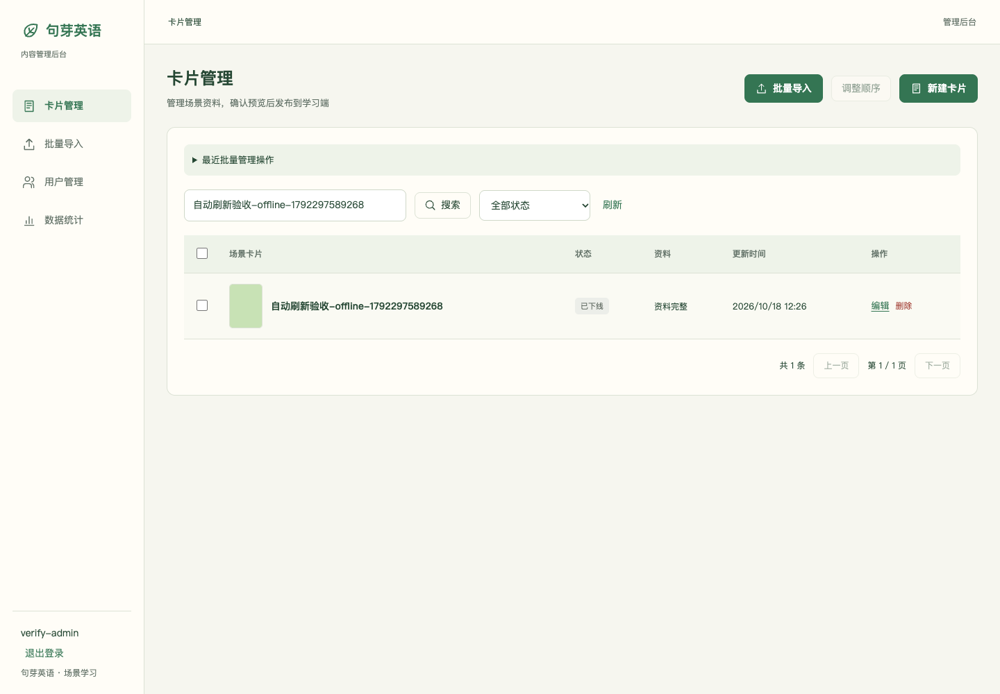
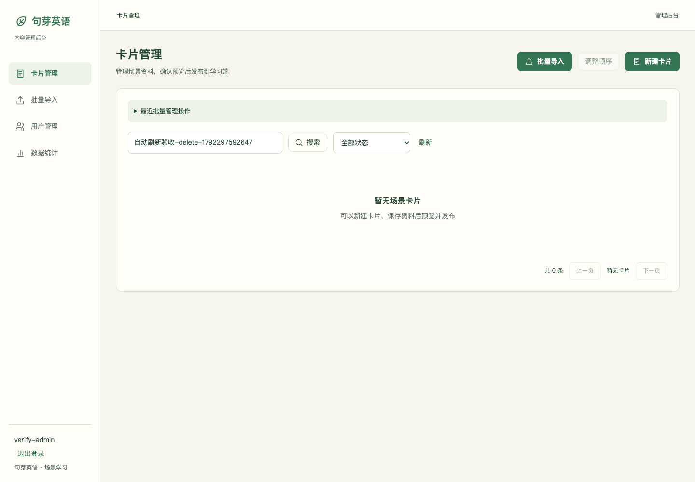
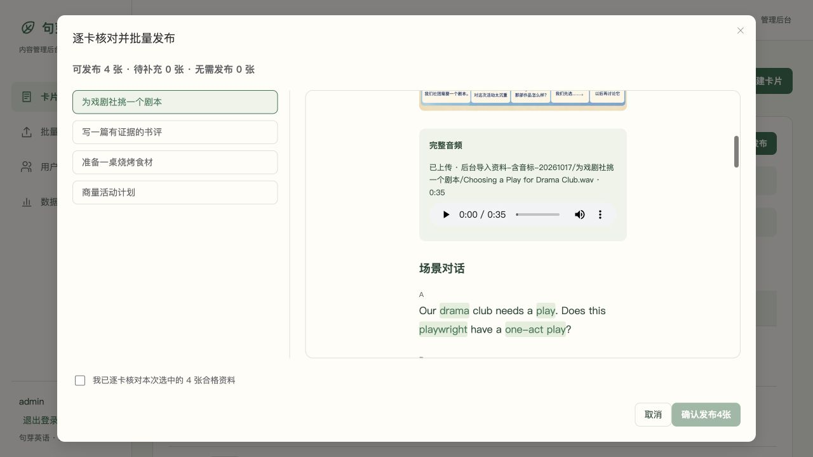
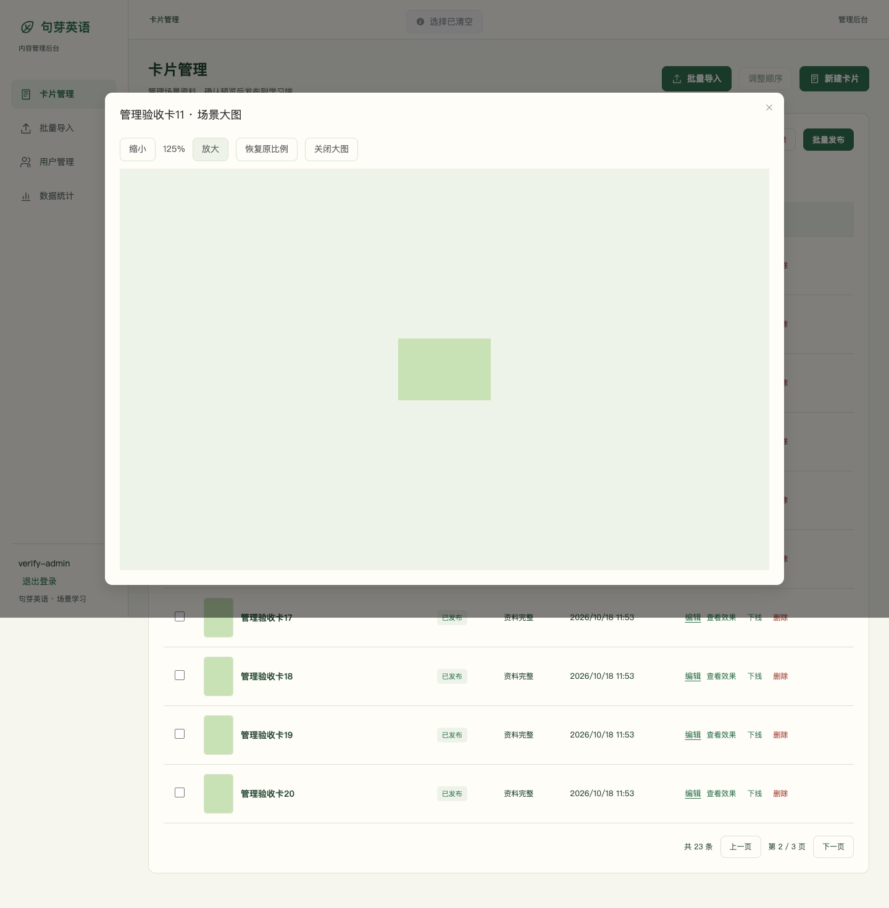
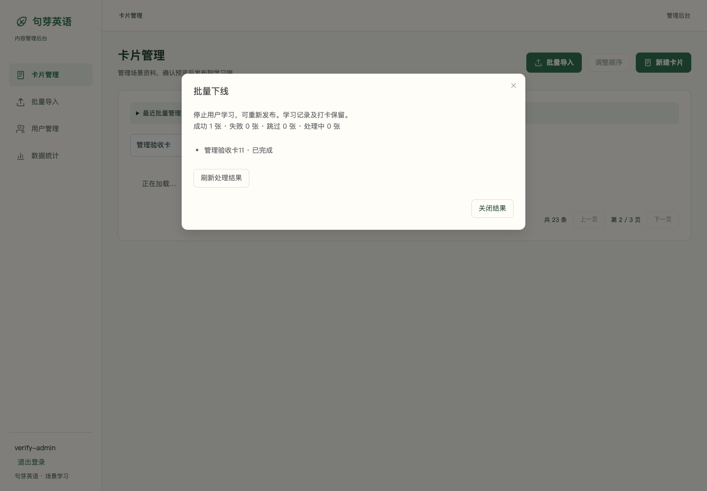
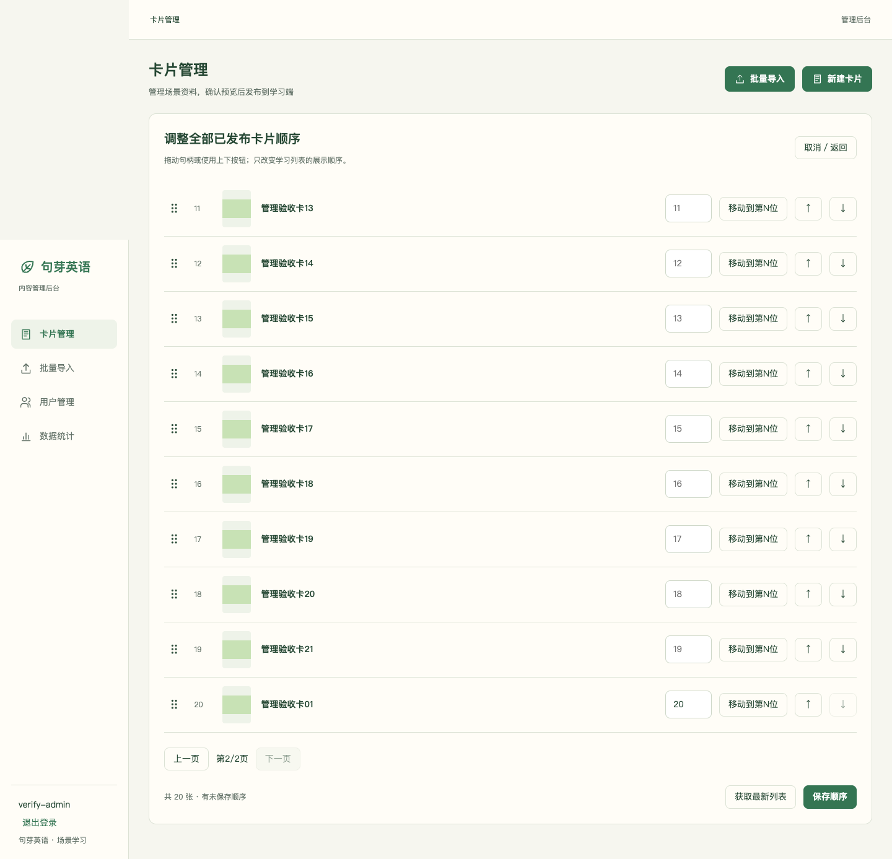

# 后台批量操作与上传优化验收 — 2026-10-18

依据工作区的《句芽英语V1.5需求文档-后台批量操作与上传优化版-20261018.md》及已批准方案。后端基线 `21f3f52`，后台基线 `ecac7b9`。本次仅修改后台和必要管理 API、Worker、迁移及管理契约；按用户后续要求整理本地提交，不推送或部署。小程序 OpenAPI 无变更。

## 实现

- 普通卡片列表与导入更新目标均由服务器分页，每页最多 10 条，返回有效页及总页数。支持当前页全选、半选、条件变化清选择、越界回退、编辑返回恢复条件及滚动位置；发布返回可定位目标卡片所在页。旧响应不能改写新的页面地址。
- 批量下线与删除分别核对，冻结原选择、状态、修订和发布版本。迁移 `0012` 新建管理批次、逐卡结果及管理素材来源表。逐卡任务复用单卡领域操作，软删除保留历史；持久结果可恢复，成功不重做，未知先查询回执，冲突只重新核对原失败集合。
- 列表原图按草稿、当前发布及最后发布版本取图，打开及重试核对版本，支持缩放、拖动及错误重试。全局排序仍提交完整快照，显示每页 10 张；支持全局位置移动，集合变化拒绝旧快照。
- 保留多 ZIP 队列与 DOCX 入口，增加拖拽、限额提示、同名包来源区分、文件状态汇总、未使用资料及失败包说明。统一报告真实传输字节，未知长度不显示假百分比；100% 与接收、解析、保存、发布分别展示。
- 音频展示原文件名、上传事实、服务器校验、真实时长及浏览器读取状态；支持读取重试和焦点互斥。新素材校验成功才更新编辑稿引用，失败或取消保留旧引用；关闭预览、切卡、离页停止试听。历史名称无法恢复时明确显示未记录。

## 验证证据

本地提交前重新验证：后端 150 项通过、7 项外部依赖跳过，Ruff 检查与格式检查、mypy 47 个源文件通过；前端 59 项通过，完整检查及构建通过。后端增加的 ZIP 文件名修复也包含在本轮后台上传改动中；两端管理 OpenAPI 语义一致，小程序契约无差异。以下较早轮次记录保留其当时的验证数量和环境边界。

- 后端全套：`python -m pytest -q`，142 通过、7 个外部环境用例跳过；Ruff 检查、格式检查和 mypy 46 个源文件通过。
- 实际独立 MySQL：迁移、管理操作、任务及学习相关 24 项通过；随后管理操作 9 项及分页／混合状态删除边界 2 项复验通过。后两轮是复验，不累计为新用例。
- 实际 Redis／独立 Celery Worker：真实素材任务、管理任务及重复投递验收 1 项通过，成功任务未重复执行。
- 前端最终全套：`pnpm test`，25 个测试文件、57 项通过；`pnpm check` 的格式、脚本、样式、类型检查及 `pnpm build` 均通过。
- 浏览器：`JUYA_ADMIN_VERIFY_FLOW=all ... pnpm exec playwright test --config playwright.admin-operations.config.ts`，6 项全部通过（1.6 分钟）。使用真实 Chrome、独立空 MySQL 数据库、独立验证 Redis、独立 Celery Worker、真实 API 与本地素材存储；不使用共享业务库及 OSS。数据库名称随机生成，结束后清理。
- 联验中曾在 SQLite 并行验证环境出现两次 `OperationalError`，上传被正确保留为接收待确认。最终验收改用上述 MySQL／Redis 完整链路，不将该轮失败记为通过，也未为 SQLite 修改业务逻辑。
- 独立只读复核发现并修复：恢复动作类型丢失、旧结果覆盖重核对、重核对重试范围丢失及迟到列表响应改写路由。新增回归先失败后通过；另覆盖失败重试回执恢复、取消上传未知态、校验阶段响应式展示及返回位置。复核结论无剩余重要问题。

## T114—T137 对照

“接口／组件”表示自动化行为验证；“Chrome”表示真实浏览器链路。未将接口或组件用例冒充逐项人工视觉验收。

| 编号 | 实现与验证                                                                                          |
| ---- | --------------------------------------------------------------------------------------------------- |
| T114 | Chrome 多选三 ZIP、移除及追加；组件拖拽；原 DOCX 入口和保存流程回归                                 |
| T115 | Chrome 单 ZIP 三文件夹、多包汇总与来源显示；后端原多 ZIP 回归保留                                   |
| T116 | 原后端包实例隔离／重复回执回归；Chrome 同名包内文件分别形成卡片                                     |
| T117 | 组件覆盖未开始移除、单项取消、兄弟继续、取消期间查询及迟到回执；取消不计成功、不重传                |
| T118 | HTTP 真实字节与未知长度事件；组件 50%／100% 后接收待确认；Chrome 后续解析与保存                     |
| T119 | Chrome 坏 ZIP／坏文件夹不阻断其余卡片；后端失败重试及去重，组件原键确认                             |
| T120 | Chrome 缺音频保存草稿，预览发布返回 422，发布版本仍为空                                             |
| T121 | 接口及组件混合状态下线、跳过与零适用禁提交；Chrome 实际批量下线                                     |
| T122 | 接口混合草稿／发布／下线直接软删除；Chrome 删除确认影响与取消保留选择                               |
| T123 | 接口部分失败／幂等／仅失败重试；组件丢响应／刷新恢复；实际 Worker 重复投递                          |
| T124 | 接口旧修订／状态及版本复核；组件原失败集合重新确认，迟到查询不覆盖核对                              |
| T125 | 列表全选／半选实现、翻页与条件变化清选择；组件及 Chrome 验证本页边界、确认取消保留选择              |
| T126 | 接口显式验证 0／1／10／11／21 条、任意大 limit 截到 10、越界页与搜索；组件分页和错误状态            |
| T127 | 接口删除末页最后卡回退有效页；下线保留全列表行；Chrome 同一筛选与总数保留                           |
| T128 | Chrome 编辑返回地址、选择及真实滚动位置恢复；原图关闭保持选择和上下文                               |
| T129 | 接口发布候选图隔离、下线最后发布图；组件及 Chrome 原图、缩放与版本失效重试；拖动及缺图状态实现      |
| T130 | 21 卡组件全局移位及完整保存，原排序冲突回归；Chrome 超 10 卡跨页移动保存；接口离线再发布亦拒旧快照  |
| T131 | 音频字段组件验证接收后校验、校验失败保留旧引用；Chrome 真实 WAV 校验及实际时长                      |
| T132 | 音频组件区分已上传与客户端读取，真实元数据就绪才开放控件，读取失败可重试                            |
| T133 | 图片／音频字段取消与回执恢复回归；音频新文件失败保留旧引用，成功后才更新编辑稿；Chrome 发布候选隔离 |
| T134 | 音频焦点及预览原有行为回归，组件切卡／卸载停播；Chrome 草稿预览、发布只读查看和离页                 |
| T135 | 接口核对学习完成统计保持及已发布数归零；成功保留／失败不执行／幂等不重做回归                        |
| T136 | 原保存／发布失败恢复回归；Chrome 上传、保存草稿、发布三个阶段，缺资料不能发布                       |
| T137 | 管理契约及生成类型同步，真实 MySQL／Redis／Chrome 联验；小程序契约不变，未同步或冒称设计源文件      |

## 交付边界

2026-10-18 后续修复：批量下线或删除仍在排队时关闭结果窗口，原先会销毁窗口内的查询，导致任务完成后列表保留旧状态。现在列表页独立跟踪未完成管理批次，状态变化后按原条件重新查询；等待较久时降低查询频率，离开列表停止查询并忽略迟到响应。新增两项回归修改前均失败、修改后通过，并覆盖超过 30 秒后完成的情况。前端全套 59 项通过，完整检查及构建通过。另以独立 SQLite／本地素材／受控 Worker 暂停开关执行真实 Chrome 两项验收：确认接收→立即关闭窗口→放行 Worker→列表自动显示已下线或移除删除行，全程未点击刷新。该次前端修复未改管理 API、未重跑云端或 MySQL 联验；上文 6 项 MySQL／Redis 联验为此前完整需求的验证记录。

批量发布弹窗样式修复：真实页面测量确认原网格容器虽限制为 432px，自动行仍被长预览撑到 3272px，导致音频及正文溢出。仅调整该弹窗样式与专属类：总高度限制在视口内，标题／确认栏固定占位，两栏可在内部滚动，窄屏切为上下布局。在 1280×720、800×600、375×667 实际视口核对无内容越界；预览滚到底部时按钮仍可见。完整检查与构建通过，未确认发布卡片，未改后端或部署。

- 新管理服务要求先执行兼容迁移 `0012`。本次未对共享测试环境或生产环境执行迁移、发布及数据清理。
- 历史素材仅从可靠导入记录恢复原文件名，无法恢复时不补造名称。尚未开始的本地文件仍需要当前浏览器保留；服务器已接收的批次及逐卡结果持久保存。
- 原有全局排序提交上限 10000 张继续保留；后台最近管理操作入口显示最近 10 次，已知批次可按 ID 查询。
- 本次浏览器素材走本地私有存储，不替代云端 OSS、腾讯云服务、微信真机或已部署环境验收。极端超长图片及全部窄屏布局未作完整视觉矩阵验收。

## 截图

