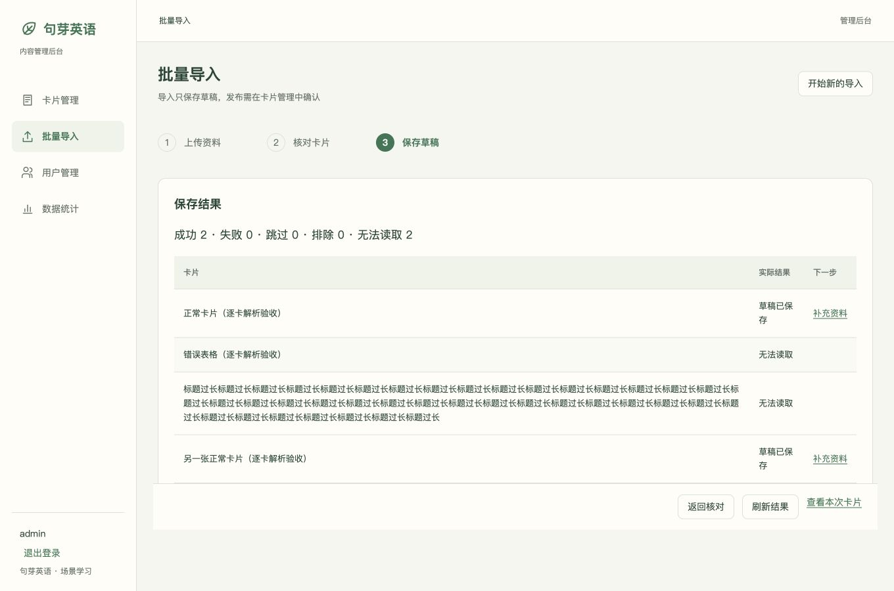

# Advanced content browser evidence

2026-10-17, isolated local QA database; actual Redis/Celery Worker and dispatcher. Synthetic administrator and learner only. Provider credentials stay outside Git.

- Reviewed two saved candidates, including a changed published card and a new card with a decoded picture and actual Tencent-generated dialogue WAV. Explicitly confirmed both previews; durable result reported two successes, zero failures. Closed and reopened the same result through the recent batch entry.
- Moved the new card above the existing card. Leaving opened the three-choice dialog; Save and leave committed the full order. Mini learning list followed that order while retaining the existing stable card's completion and 1-card/1-day statistics.
- Admin and mini controlled vocabulary requests reached the playing state through real cloud synthesis and subsequent cache replay. This is browser WAV evidence; production MP3 decoder and WeChat device acceptance remain separate work.
- Screenshots: `admin-batch-review.png`, `admin-batch-result.png`, `admin-order-leave.png`, `admin-pronunciation.png`. Mini evidence is in the mini repository's `docs/verification/mini-published-order.png` and `mini-batch-pronunciation.png`.

Regression evidence: 24 admin behavior tests passed; full format, lint, style, TypeScript checks and production build passed. Newly reproduced cases distinguish a confirmed expired-preview rejection from an unknown network result, and recover cancelled upload acceptance without retransmitting or replacing the old media early.

The import workflow now has browser evidence:

- A synthetic ZIP yielded one complete card, one recoverable incomplete card and one rejected multi-card folder. An unused file remained unbound. Switching cards retained edits; leaving and resuming restored names and the explicitly reviewed update target.
- The final confirmation listed one update and one new draft, with one incomplete item. Formal cards were unchanged before confirmation. Actual Worker results then reported two saved drafts, zero failures and one unreadable folder. The batch filter showed only those two cards; the published version stayed separate from the updated candidate.
- Single-card DOCX rejected multiple H1 cards, then displayed a legitimate one-card before/after preview. Explicit replacement kept the hand-entered title; subsequent Save draft persisted it.
- Import staging audition reached the replay control through the controlled staging reference, with no intermediate formal card save. The server rechecks staging revision for audio grants.
- Additional screenshots: `admin-import-target.png`, `admin-import-confirmation.png`, `admin-import-result.png`, `admin-import-review.png`, `admin-single-docx.png`.

Latest frontend: 29 behavior tests, full static/types and production build passed. Regression cases also cover late typing during staging save, original-receipt recovery, explicit single-DOCX text replacement and invalidating target confirmation after content changes.

Actual device behavior, independent deployment/rollback, mixed concurrency acceptance, complete revision12 visual QA and OSS reset are still pending. Archive decoder/budget and final review work continue.

## 独立审查后的恢复验证

新建卡提交已成功但回执丢失，再修改名称并保存：回归先复现两次不同幂等键创建，修复后原键收尾只创建一个稳定卡片，随后PUT保存当前修改。完整31项后台测试、格式/脚本/样式/类型检查及构建通过。

多卡DOCX实测使用同一文件中的两张正常卡、一张错列表格、一张超长标题。真实本地Worker逐卡解析，正常2张进入核对，错误2张显示原因且不可误选；确认后仅2张正常卡保存为草稿，原文件和逐卡结果保留。本次使用隔离SQLite、真实Redis/Celery及本地私有素材，尚不证明OSS或云端压测。

