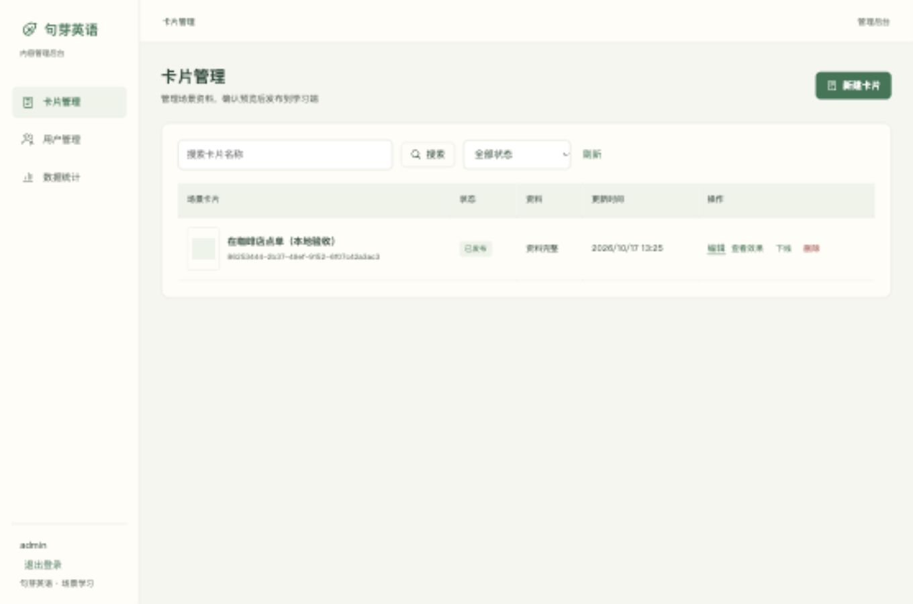

# 核心闭环验证 — 2026-10-17

环境：独立本地SQLite数据库、真实新管理API、私有本地素材适配器、1360×900桌面视口，非生产环境。

使用CUA浏览器实际验证：管理员登录；上传可解码PNG及2秒WAV；录入对话、词汇并自动定位唯一原句；保存草稿；预览及确认发布；成功回到列表；保存新的候选名称后列表和只读预览仍显示原发布名称；A07真实返回零用户、一张已发布卡片。

浏览器发现并修复发布成功后被自己的忙碌导航保护拦截，新增回归测试先失败再通过。13项前端行为测试通过，Vue类型检查和生产构建通过。`pnpm check`（格式、脚本与样式检查、Vue类型检查）、`pnpm test`（13项）及 `pnpm build` 均已通过。

此验证不覆盖微信真机、OSS、腾讯云发音、导入或部署。Playwright端到端源码尚未执行；本次浏览器操作通过CUA完成，不将源码存在视为测试通过。

追加验证：退出登录先显示编辑页三选一离开确认；取消时不撤销服务器会话，保留当前输入。根界面回归测试验证取消时不发送注销请求；确认后才注销。
